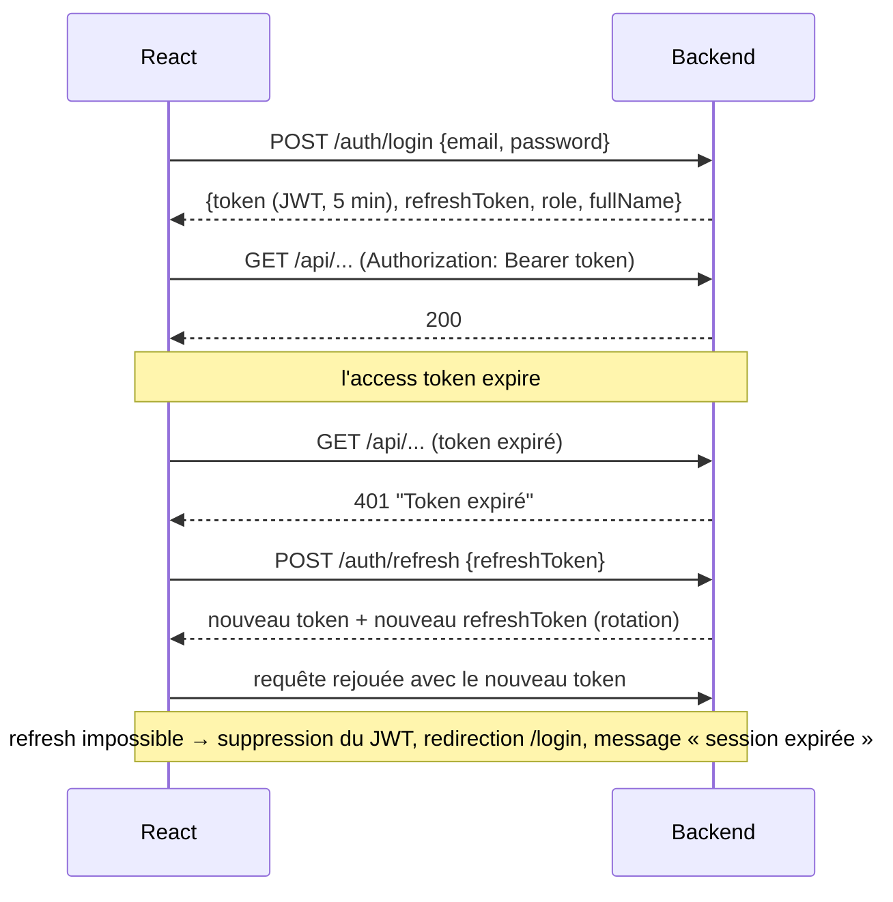

# Architecture générale

```mermaid
flowchart TB
    subgraph Browser["Navigateur — React 18 + Vite (:5173)"]
        P[Pages] --> AC[AuthContext]
        P --> PR[ProtectedRoute / RoleRoute]
        P --> S[services/*.js]
        S --> AX[Axios api.js<br/>interceptor requête : Authorization Bearer<br/>interceptor réponse : 401 → refresh ou retour /login]
    end
    AX -- "HTTP / JSON" --> CORS
    subgraph Backend["Spring Boot (:8080)"]
        CORS[CorsFilter] --> JF[JwtAuthenticationFilter]
        JF --> SC[SecurityFilterChain<br/>règles d'URL + 401/403 JSON]
        SC --> C[Controllers<br/>@Valid + @PreAuthorize]
        C --> SV[Services<br/>règles métier + contrôle du propriétaire]
        SV --> R[Repositories Spring Data JPA]
    end
    R --> DB[(H2 en mémoire / MySQL)]
```

## Flux d'authentification



## Sécurité en couches

1. **Règles d'URL** (`SecurityConfig`) : `/auth/**` et `/h2-console/**` publics, `/api/admin/**` ADMIN, `/api/**` authentifié.
2. **`@PreAuthorize`** sur les contrôleurs (rôle).
3. **Services** : droit d'accéder à CET incident (propriétaire, technicien affecté) vérifié côté serveur.
4. **Filtre JWT** : l'utilisateur est rechargé en base à chaque requête, donc un compte désactivé ou un rôle modifié prend effet immédiatement.
