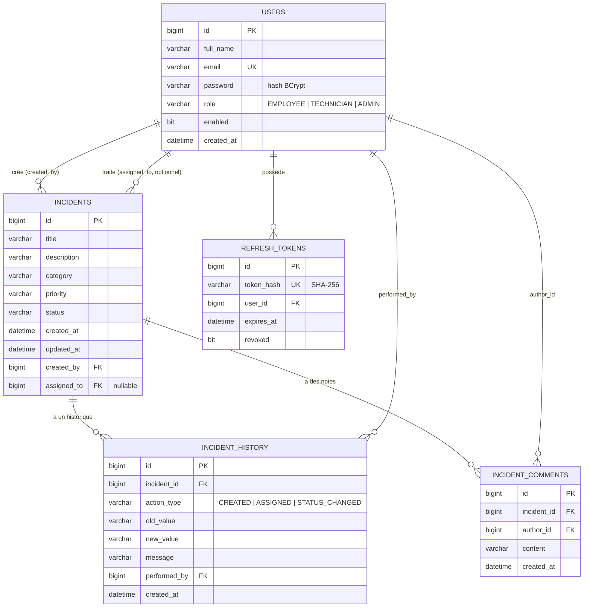

# Diagramme des entités

## Choix JPA (travail de recherche, section 4 du devoir)

- **`@ManyToOne(fetch = LAZY)`** pour `createdBy` et `assignedTo` : l'utilisateur n'est chargé que si on le lit. Les listes utilisent `@EntityGraph` pour les charger en une seule requête (pas de N+1). `EAGER` a été écarté : il charge toujours les utilisateurs, même inutiles.
- **Pas de `@OneToMany`** : `User.incidents` serait une collection potentiellement énorme et jamais utilisée en entier ; l'historique et les notes d'un incident sont lus par clé étrangère (`findByIncidentId...`), ce qui évite aussi les `LazyInitializationException` avec `open-in-view=false`.
- Les énumérations sont stockées en `EnumType.STRING` (lisibles, insensibles à l'ordre des constantes).
